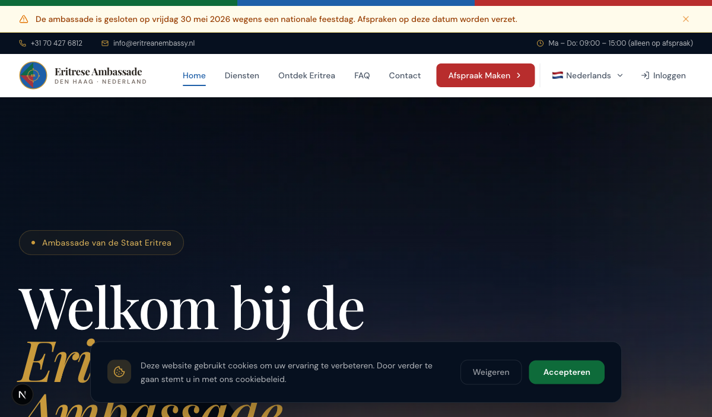
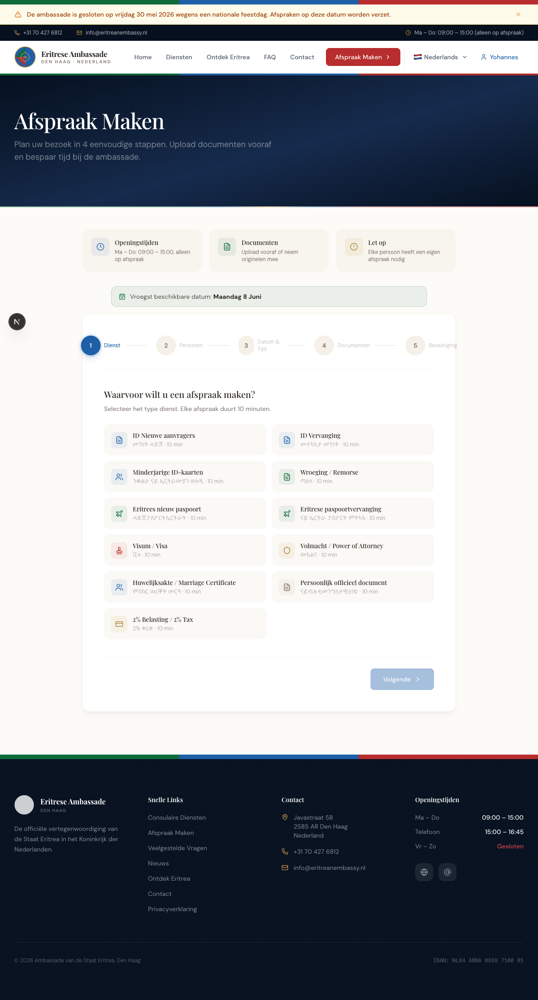
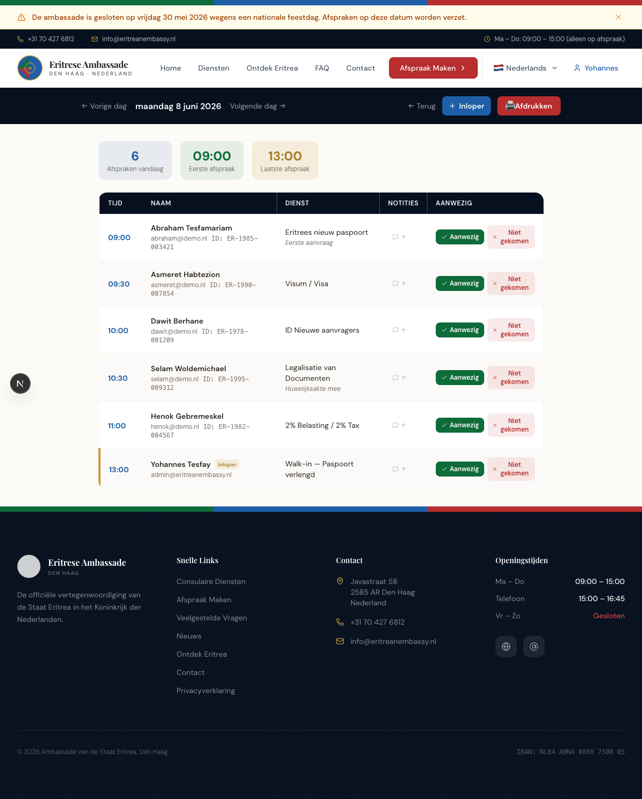
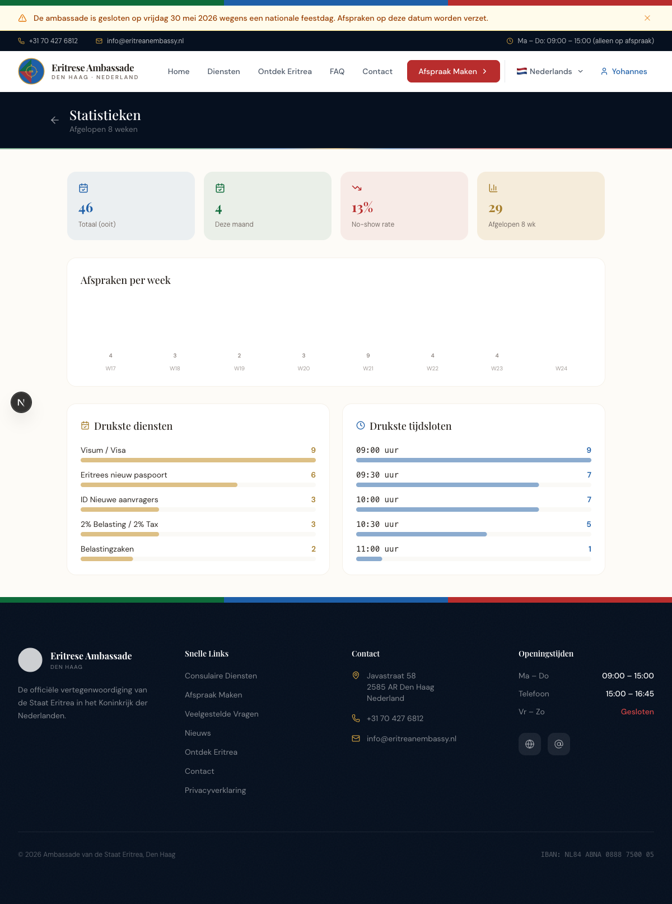

# Eritrean Embassy Appointment System

A full-stack web app for managing embassy appointments, citizen documents, and daily front-desk operations. Self-initiated — built to understand and streamline a real administrative workflow, not assigned coursework. Currently in discussion with the embassy about potential real-world use; not yet officially deployed.

**[→ View the project showcase](https://yoelhaddis-rgb.github.io/updated-embassy/)** (once GitHub Pages is enabled for this repo)

## Demo

[▶ Watch the walkthrough video](docs/demo.mp4) — a recorded click-through of the citizen and admin flows.

## Screenshots

| | |
|---|---|
|  |  |
| Landing page | Citizen appointment wizard |
|  |  |
| Admin daily schedule (`dagschema`) | Admin statistics dashboard |

## Features

**Citizen portal**
- Account registration and login (JWT-based sessions)
- Book, reschedule, and cancel appointments
- Upload and track required documents
- Manage family member records
- Track tax payments and reminders
- News feed, FAQ, and general information pages

**Admin dashboard**
- Daily schedule (`dagschema`) — printable, with walk-in support and live check-in / no-show tracking
- Appointments overview with day-by-day filtering
- Citizen and staff management
- Statistics dashboard — weekly volume, no-show rate, top requested services
- News management and site settings
- Automated jobs: appointment reminders, no-show follow-up, tax payment reminders, document cleanup, morning digest email

## Tech stack

- [Next.js 16](https://nextjs.org/) (App Router) + React 19 + TypeScript
- [Prisma ORM](https://www.prisma.io/) — PostgreSQL in production, with SQLite/libSQL adapters for local development
- Tailwind CSS 4
- Authentication via `jose` (JWT) and `bcryptjs` (password hashing)
- Email via `nodemailer`
- Scheduled jobs for reminders, cleanup, and digests

## Getting started

```bash
npm install
cp .env.example .env     # fill in your own values
npx prisma generate
npx prisma migrate dev
npm run seed              # optional: seed sample data
npm run dev
```

## Project structure

```
src/app/              citizen-facing routes (appointments, account, documents, news, ...)
src/app/admin/        admin dashboard (dagschema, afspraken, burgers, statistieken, ...)
src/app/actions/      server actions (data mutations)
src/app/api/cron/     scheduled jobs (reminders, cleanup, digests)
prisma/schema.prisma  data model
```
